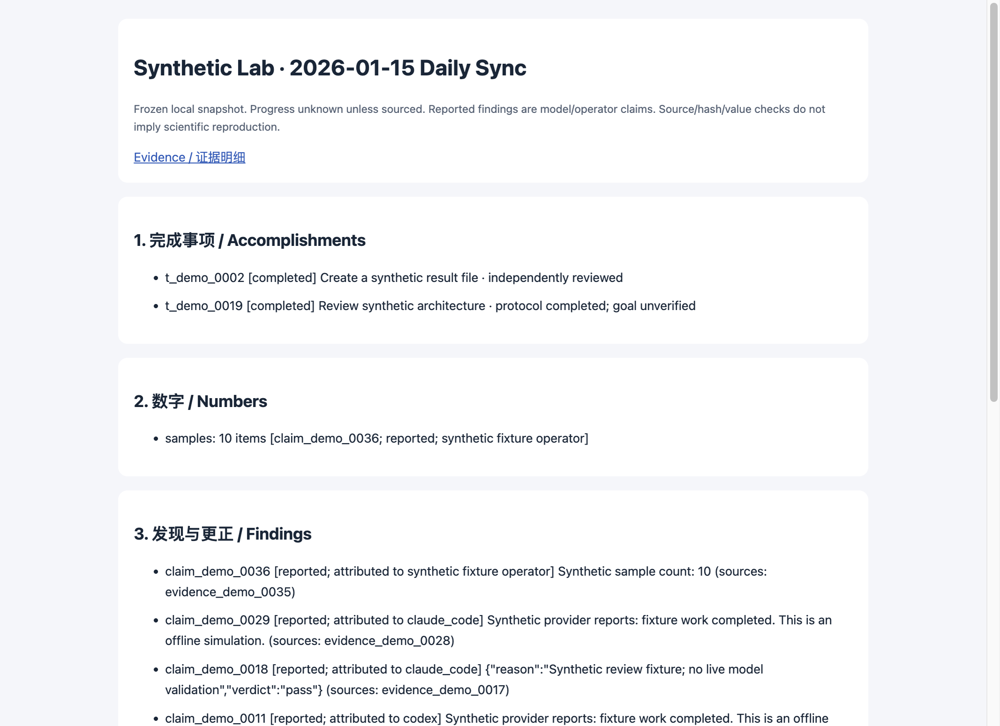

# Work Assistant

**Turn coding-agent work into traceable tasks, evidence, and daily reports.**

A local-first work assistant for individual developers already using Codex or Claude Code. Reuse your installed CLIs, retain execution records and attributed evidence, correct findings, and produce offline reports. Feishu delivery is optional and requires explicit authorization.

[中文](README.md) · [Quickstart](docs/quickstart.en.md) · [Documentation](docs/README.md) · [Contributing](CONTRIBUTING.md) · [Changelog](CHANGELOG.md)

**Alpha · Python 3.9+ · macOS / Linux · MIT · No third-party runtime dependencies**

## See a report first

```sh
git clone https://github.com/xilinshancun/work-assistant.git
cd work-assistant
python3 -m work_assistant demo --output out/demo
```

Open **`index.html`** inside the `report_path` printed in the JSON result. Inspect tasks, sourced numbers, corrections, and next steps; `card-preview.html` previews the summary card.

Once the source is available, the demo runs offline without pip, model credentials, Paseo, or Feishu. All inputs and executors are deterministic synthetic fixtures: **this is not live model or delivery validation**. Repeating a complete demo returns the same result.



## Try your own project

Install and sign in to your own Codex CLI first: it is currently the smallest provider setup for a real task. From this repository, replace the workspace path with your project:

```sh
python3 -m work_assistant init
python3 -m work_assistant doctor
python3 -m work_assistant project add my-project --workspace /absolute/path/to/project
python3 -m work_assistant ask my-project 'Read-only: compare the README with the implementation; cite evidence and open questions' --provider codex
```

Tasks default to read-only and never automatically publish. Inspect the returned `task_id` with `task show TASK_ID`, then use `report my-project --date YYYY-MM-DD` to create a report. Follow the [quickstart](docs/quickstart.en.md) for installation as `wa`, review, and report output.

Claude Code is an optional executor and independent reviewer. DSH is an optional fast classifier. **Choosing an executor does not bypass routing**: Claude Code alone cannot complete the default task flow; complex routing needs the Codex planner. See [dependencies and validation scope](docs/capabilities.md).

## Why use it?

- **Resume from records.** Tasks, routing decisions, provider sessions, results, and blockers persist in a local journal.
- **Keep reports grounded.** Source observations and model claims are distinct, with attribution, hashes, and correction history. Previous reports remain immutable.
- **Understand completion.** Protocol completion, an unverified goal, and independent review are separate states.
- **Inspect delivery.** Optional Feishu publishing previews content, records intent and remote IDs, then reads back results. Uncertain writes are not automatically replayed.

```text
Your project → Task → Existing coding CLI → Execution / Evidence / Corrections
                                                       ↓
                                           Local HTML / Markdown report
                                                       ↓ explicit authorization
                                           Optional Feishu document / card
```

The focus is personal developer handoffs and reporting. There is no team dashboard, general chat-channel platform, or built-in scheduler. Local storage does not make model calls offline. Read the [capability boundaries](docs/capabilities.md) and [positioning, alternatives, and roadmap](docs/positioning.md).

## Go deeper

| Goal | Documentation |
| --- | --- |
| Install, run a task, create a report | [English quickstart](docs/quickstart.en.md) / [中文上手](docs/quickstart.md) |
| Evidence, corrections, recovery | [Detailed reference](docs/guide.md) (Chinese) |
| Import an existing report pipeline | [Import reference](docs/guide.md#导入已有的本地日报), [synthetic bundle](examples/daily-bundle) |
| Send Feishu text or display cards | [Setup](docs/guide.md#飞书预览和真实发布), [message commands](docs/messages.md) |
| Maintain a dated document | [Timeline trees](docs/timeline-trees.md) |
| Owner-only mentions and deep analysis | [Optional inbound](docs/inbound.md) (disabled by default; additional dependencies and tenant checks) |
| Troubleshoot | [Troubleshooting](docs/troubleshooting.md), [security model](SECURITY.md) |

## Contribute

Try the demo and one read-only task, then tell us where you got stuck. [Report an issue](https://github.com/xilinshancun/work-assistant/issues/new/choose) with the version, platform, sanitized command, and observed result. Do not attach private journals, credentials, or company material.

See [CONTRIBUTING.md](CONTRIBUTING.md) for development and tests, and [SECURITY.md](SECURITY.md) for security reporting. [MIT License](LICENSE).
